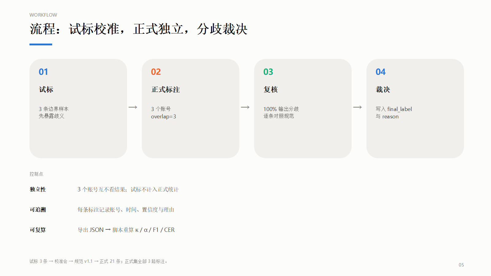
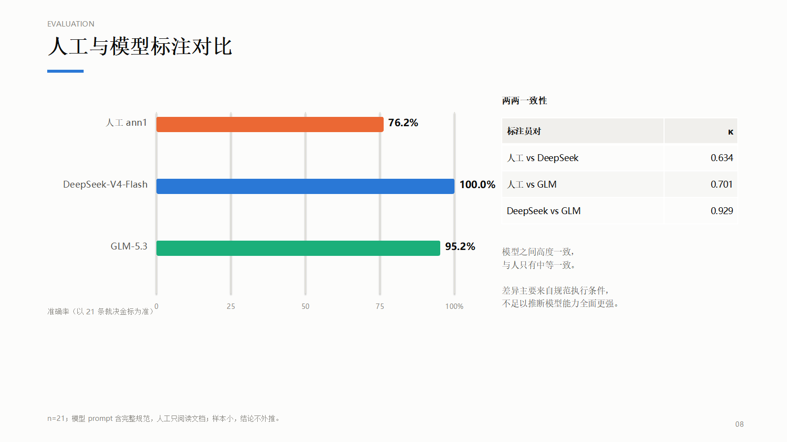

# 多模态数据标注与质检

一次可复核的三模态标注实验：标注规范、多人一致性、分歧裁决，以及人工与 LLM 的标注对比。


<p align="center">
  
</p>

## 项目简介

仓库记录了一次完整的三模态标注运行，使用 Label Studio 完成：

- 24 条中文外卖评论，标注情感、方面、质量标记和置信度
- 6 张图像，标注目标框
- 10 条中文语音，修正 ASR 转写

文本集由 1 名人工和 2 个模型（DeepSeek-V4-Flash、GLM-5.3）分别标注。流程包括试标、独立标注、100% 分歧复核和裁决，最终得到 21 条文本金标。

这是一个小规模、可完整复现的项目，不是生产级标注平台。标注质量通常靠抽检和感觉判断；这里把过程拆成规范、试标、重叠标注、裁决和指标，每一步都能复查。仓库同时保留了原始任务、分歧记录和可复算的脚本。

## 结果

| 项目 | 规模 | 结果 |
|---|---|---|
| 文本 | 24 条（正式 21）× 3 路 | 两两一致率 84.1%；Fleiss' κ 0.756；α 0.760 |
| 人工 vs 模型 | 21 条金标 | DeepSeek 100%、GLM 95.2%、人工 76.2% |
| 图像 | 6 张；正式集 5 张、52 个框 | 单人标注，未计算 IAA |
| 语音 | 10 条（正式 9） | CER 5.5% → 1.1% |

主要发现：

- 文本分歧不在“正面/负面”，而在边界样本。5 条人工错误全部落在广告、超短、混合情感、平淡陈述、隐私文本五类。
- 两个模型之间一致性很高（κ 0.929），人机一致性中等（0.63–0.70）。模型在 prompt 中拿到完整规范，人工只阅读文档，条件并不对等。
- 语音修正把 CER 从 5.5% 降到 1.1%，9 条中 7 条完全正确。
- 图像只有一名标注员，本轮不能计算 IAA；这是当前主要缺口。

## 人工与模型

<p align="center">
  
</p>

按裁决金标，DeepSeek 21/21 正确，GLM 20/21，人工 16/21。模型的高准确率至少部分来自“规范被直接放进上下文”，因此这组数字更适合说明规范执行条件的影响，不适合作为模型能力排名。

完整指标、每类 F1、混淆矩阵、置信度校准和 token 成本见 [模型评测](docs/model-evaluation.md)。

## 设计取舍

- **情感与质量标记分开**：广告、隐私、无意义内容先判“无法判断”，避免和情感极性混在一起。
- **试标不计入正式统计**：先用 3 条边界样本暴露歧义，再冻结规范 v1.1。
- **模型定位为预标注**：模型间一致性高，但人机一致性中等，最终标签仍需人工裁决。

替换 `configs/` 和 `data/` 后，这套流程可以迁移到其他分类、抽取或框标注任务；一致性、裁决和报告脚本大部分可直接复用，任务字段需要按新 schema 调整。对评测工作，这些记录可以直接用于规范评审、预标注验收和分歧定位。

## 快速开始

```bat
git clone https://github.com/lhh737/multimodal-annotation-qc.git
cd multimodal-annotation-qc
python -m venv .venv
.venv\Scripts\activate
pip install -r requirements.txt
```

启动 Label Studio 和数据服务：

```bat
start_label_studio.bat
start_data_server.bat
```

完整流程见 [复现指南](docs/reproduce.md)。标注并导出后，运行分析：

```bat
.venv\Scripts\python.exe scripts\analyze.py --text exports\text.json --image exports\image.json --audio exports\audio.json
.venv\Scripts\python.exe scripts\compare_models.py
```

## 文档

| 文档 | 内容 |
|---|---|
| [标注规范](docs/annotation-guideline.md) | 标签定义、判定顺序、五条边界条款、质检指标 |
| [质检报告](docs/qc-report.md) | 一致性、错误分析、置信度、改进建议 |
| [模型评测](docs/model-evaluation.md) | 人工与 LLM 的准确率、F1、κ、成本与限制 |
| [复现指南](docs/reproduce.md) | 安装、项目创建、导出、分析与模型标注 |
| [幻灯片](docs/slides/multimodal-annotation-qc.pdf) | 12 页项目汇报，[PPTX](docs/slides/multimodal-annotation-qc.pptx) 可编辑 |

## 仓库结构

```text
configs/   Label Studio 标注界面
data/      文本、图像、语音任务与图像素材
docs/      规范、报告、复现指南、图表、幻灯片
reports/   指标与逐条结果（CSV / JSON）
scripts/   数据生成、标注、一致性、模型评测、PPT
```

关键脚本：

| 脚本 | 用途 |
|---|---|
| `prepare_text.py` / `prepare_images.py` / `generate_audio.py` | 生成任务数据 |
| `setup_projects.py` | 创建项目、导入任务、设置 overlap |
| `analyze.py` | 计算一致率、κ、α、图像 F1、语音 CER |
| `compare_models.py` | 人工 vs 模型的准确率、F1、混淆矩阵、校准 |
| `make_ppt.py` | 生成汇报幻灯片 |

## 数据与许可

- 图像来自 Unsplash，来源见 [ATTRIBUTION](data/images/ATTRIBUTION.md)。
- 文本样本来自 waimai_10k 与人工构造的边界样本；任务固定写在 `data/text/tasks.json`，不依赖原始数据集。
- 语音为 Windows 中文 TTS 合成加受控 ASR 错误，不含真实用户录音。
- 代码使用 MIT 许可。

## 局限

- 文本正式集 21 条，κ 和准确率的置信区间较宽，结论只代表本轮。
- 人工只有 1 人，图像没有第二人复标。
- 模型 prompt 含完整规范，与人工条件不对等。
- 语音为合成数据，不完全等同于真实 ASR 噪声。
